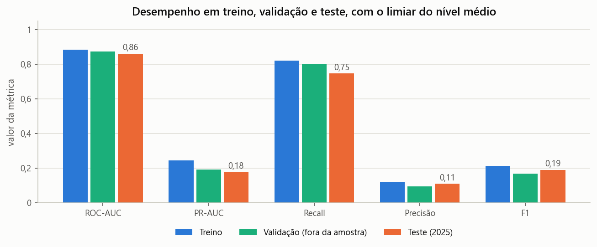
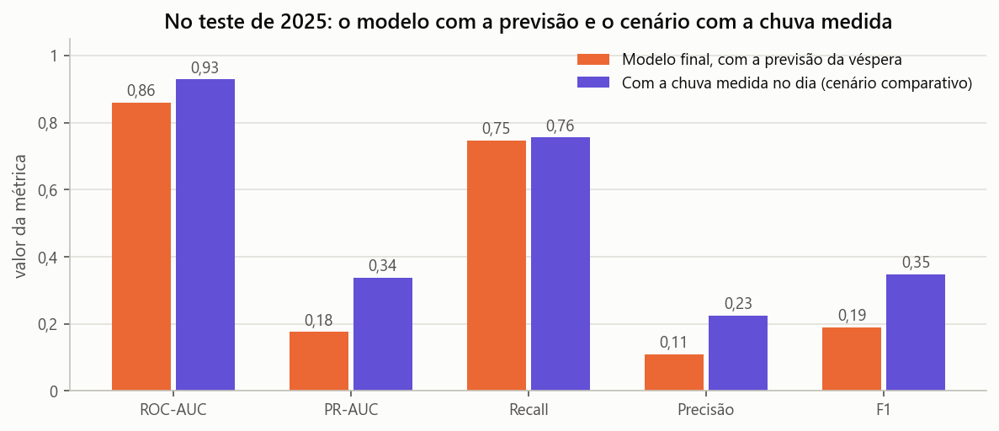

# Elo: nível de atenção por subprefeitura em dias de chuva

**GS 2026.2 · IA & ML** · Equipe (RM): Lucca Borges (554608), Ruan Melo (557599), Rodrigo Jimenez (558148), João Victor Franco (556790) e Bruno Leão (555563) · [Notebook](elo_nivel_atencao.ipynb) · [Dados](dados/README.md) · [Uso de IA](prompts.md)

## 1. Problema e pergunta de ML

No Elo, o coordenador do bairro vê quais ruas ficaram em silêncio durante a chuva. Esse dado ainda não existe de verdade, e dados simulados não são aceitos. Por isso, o ML responde à pergunta anterior, que tem dado real: **em que dias vale abrir a chamada?** A premissa, ainda não validada com lideranças, é que abrir a chamada em todo dia de chuva cansaria os voluntários.

Na manhã de cada dia, para cada subprefeitura, o modelo estima a chance de o CGE registrar ao menos um ponto de alagamento: classificação binária com 35.072 linhas (32 subprefeituras × 1.096 dias) e 3,15% de positivos. A chance vira um nível, ainda não integrado à tela Bairro: **baixo** (nada muda), **médio** (a partir de 3,1%: avisar as lideranças) e **alto** (a partir de 10,7%: abrir a chamada). O modelo não emite alerta, não aponta rua e não diz se há perigo.

## 2. Dados reais e públicos

| Fonte | Uso | Período | Link |
|---|---|---|---|
| CGE-SP, pontos de alagamento | Alvo | 2023 a 2025 | [cgesp.org](https://www.cgesp.org/v3/alagamentos.jsp) |
| Open-Meteo Previous Runs, previsão JMA emitida 24 h antes | Variável do modelo | 2023 a 2025 | [open-meteo.com](https://open-meteo.com/en/docs/previous-runs-api) |
| INMET A701 e A771 (medição) e Open-Meteo (reanálise) | Conferência e comparação | 2023 a 2025 | [inmet](https://portal.inmet.gov.br/dadoshistoricos), [reanálise](https://open-meteo.com/en/docs/historical-weather-api) |
| GeoSampa e Open-Meteo Elevation | Local e candidatas | Consulta em 08/11/2026 | [geosampa](https://geosampa.prefeitura.sp.gov.br), [elevation](https://open-meteo.com/en/docs/elevation-api) |

Nada é simulado. A base do escopo foi reconstruída das fontes, com números próximos (2.159 registros brutos, 2.155 sem duplicatas, contra 2.137; Sé com 339 contra 335). A JMA é o único modelo da API com previsão desde 2023, vem em blocos de 6 horas e cobre a cidade em 3 pontos de grade. No treino, ela correlaciona 0,55 com a estação A701 e 0,33 com a A771, contra 0,68 e 0,55 da reanálise.

## 3. Escolha do modelo

Cinco modelos da lista passaram pela mesma validação cruzada, com as variáveis finais. PR-AUC médio: **Regressão Logística 0,218**, XGBoost 0,208, MLP 0,204, Random Forest 0,186 e Naive Bayes 0,178. Modelo, variáveis e hiperparâmetros seguem uma regra única: entre os equivalentes ao melhor (dobra a dobra, até um erro-padrão ou 0,005, por convenção), fica o mais simples. O XGBoost empata com ela, na validação e no teste; fica a mais simples. LSTM pede sequências longas, e KMeans não usa rótulo.

## 4. Preparação e divisão

Removemos 4 duplicatas, padronizamos as 32 subprefeituras e convertemos o INMET para horário local. Só entra no modelo o que existe na manhã do dia: a previsão da véspera (total e intensidade do bloco de 6 horas mais chuvoso) e a subprefeitura. Sete grupos extras, como mês e chuva medida até a véspera, foram testados um a um, e nenhum superou essa base pela regra. O pré-processamento fica no `Pipeline`.

A divisão é **temporal**: treino em 2023 e 2024 (23.392 linhas, 3,27% de positivos) e teste em 2025 (11.680 linhas, 2,90%), pois sortear colocaria o mesmo temporal nos dois lados. O ano de 2025 não é um teste cego: o escopo já o usava, e as métricas foram vistas durante o desenvolvimento. Por isso, toda escolha usa só a validação no treino.

## 5. Treino com diferentes hiperparâmetros

Testamos **24 combinações de 3 hiperparâmetros** (`C`, `l1_ratio` e `class_weight`), com **validação cruzada temporal de 5 dobras, por dia e só no treino**. A métrica principal é o PR-AUC, adequado a classes raras (dizer sempre "não alaga" acerta 97%). A melhor combinação (`C`=10, L1) fez 0,218. Seis das 24 empataram com ela, e a regra ficou com a mais simples: `C`=1, L1, sem peso (0,217). As dobras têm de 13 a 197 casos, o que dá pouco poder à busca. Os limiares vêm só do treino: o médio cobre 80% dos alagamentos na validação, e o alto maximiza o F1.

## 6. Resultados em treino e teste

| Métrica | Treino | Validação (CV) | Teste 2025 | Teste, com a chuva medida |
|---|---|---|---|---|
| ROC-AUC | 0,885 | 0,875 | **0,860** | 0,929 |
| PR-AUC | 0,245 | 0,190 | **0,176** | 0,338 |
| Recall | 0,820 | 0,801 (alvo) | **0,746** | 0,755 |
| Precisão | 0,121 | 0,094 | **0,109** | 0,226 |

 

*Recall e precisão no limiar do nível médio. Figura 1: treino, validação e teste. Figura 2: cenário com a chuva medida.*

**Referências no teste (PR-AUC):** modelo 0,176 (IC95% 0,120 a 0,252), XGBoost 0,173 (empate: IC95% pareado de -0,018 a +0,027), só a previsão 0,112, só o local 0,058, acaso 0,029. A vantagem sobre a previsão sozinha se sustenta (IC95% pareado por dia: +0,041 a +0,093) e vem de saber onde o CGE registra. Com a chuva medida, o PR-AUC iria a 0,338 (Figura 2): a incerteza da previsão pesa, mas não é o único limite.

**Overfitting (Figura 1).** Convenção nossa: queda do PR-AUC ao sair do treino (até 10% leve, até 30% moderado, acima disso forte). Na busca, de 0,296 para 0,217 (27%); do treino final ao teste, de 0,245 para 0,176 (28%). É moderado e não vem de flexibilidade: de `C`=1 a 100, treino e validação quase não mudam. A validação foi otimista: o teste fica 7% abaixo das previsões reunidas (0,190) e 19% abaixo da média das dobras (0,217). Previsto e real por nível no teste: alto, 19,5% e 19,2%; médio, 5,7% e 7,0%; baixo, 0,9% e 0,9%; acima de 30% (95 casos), 38,6% e 27,4%.

## 7. O que o resultado significa para o cidadão

- **Abrir a chamada ou se preparar.** De cada 100 alagamentos registrados em 2025, o nível alto abriria a chamada em 42, e 81 de cada 100 chamadas seriam à toa. Os níveis médio e alto cobriram 75 de cada 100, abaixo do alvo de 80, e em 89 de cada 100 desses dias não houve registro. Cada subprefeitura ficaria em média 73 dias por ano em médio ou alto, 23 deles em alto, e por isso o médio só prepara.
- **Onde o modelo quase não avisa.** Onde o CGE registrou pouco no treino (até 15 casos), o nível alto cobre 15 de cada 100 alagamentos, contra 61 onde registrou mais de 40. Em 8 das 32 subprefeituras, o alto nunca apareceu; em Guaianases, nenhum dia entrou em atenção, apesar de 4 alagamentos. Não é economia: é o modelo repetindo a falta de registro. Um piso de atenção, em que a previsão sozinha já subisse ao médio, levaria a cobertura nesses lugares de 48 para 77 em 100, com 91 dias em atenção em vez de 29. A decisão é da comunidade.
- **Ele responde em que dia, não onde.** 27 das 32 subprefeituras recebem a mesma previsão, e dentro do dia o modelo repete quase a lista da frequência histórica (correlação 0,97).
- **Nível baixo não quer dizer seguro.** Caíram nele 25 de cada 100 alagamentos. Se a água sobe, vale o que a rua vê e o aviso oficial.
- **O dado não é a rua.** 54% dos pontos estão em avenidas, e 39% duram menos de 1 hora. O quanto o registro reflete onde o CGE observa é hipótese. Pontos longos, intransitáveis ou fora de avenidas têm cobertura parecida (75% a 77%). Em 20% dos casos, todos os pontos começaram antes da decisão, às 8h; sem eles, o nível alto cobre 45 de cada 100 alagamentos.
